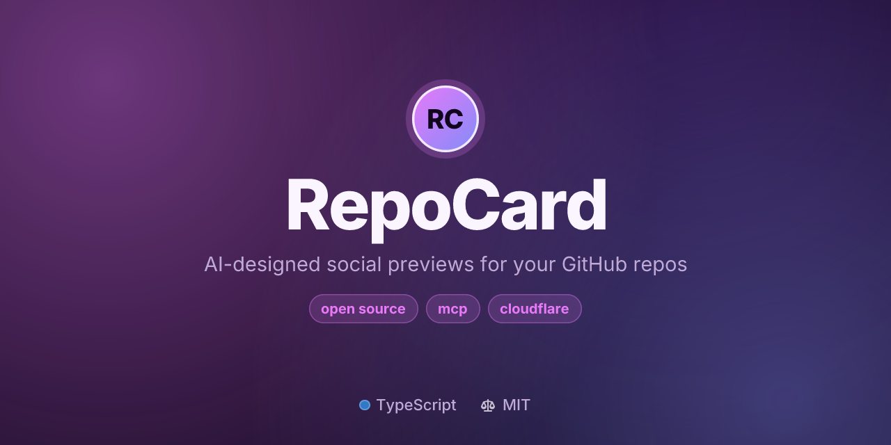
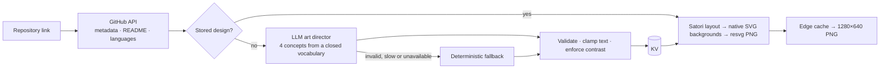

<p align="center">
  
</p>

<h1 align="center">RepoCard</h1>

<p align="center">
  <strong>AI-designed social preview images for your GitHub repos.</strong><br>
  Paste a link. RepoCard reads your README, designs four original cards, and renders crisp 1280×640 PNGs.
</p>

<p align="center">
  <a href="https://repocard.example.com">Website</a> ·
  <a href="https://repocard.example.com/bulk/">Bulk export</a> ·
  <a href="https://repocard.example.com/docs/">Docs</a> ·
  <a href="#for-ai-agents">MCP server</a> ·
  <a href="https://www.npmjs.com/package/repocard">CLI</a>
</p>

<p align="center">
  <a href="LICENSE"></a>
  <a href="https://www.npmjs.com/package/repocard"></a>
  
  
</p>

---

The **social preview** is the image people see when your repository link is shared on X, LinkedIn, Slack, Discord or iMessage. Most repos show GitHub's generic card, and template generators put every project on the same layout. RepoCard designs a card that fits *your* project instead.

- **Designed, not templated.** An LLM reads the description, README, topics and languages, then art-directs four distinct concepts: layout, palette, typography, a one-line tagline and keywords.
- **Crisp, correct text.** The model never draws pixels. Code renders the design with real fonts, so there's no garbled AI lettering. Output is exactly 1280×640 and under GitHub's 1 MB limit.
- **Always legible.** Sixteen curated palettes that pass WCAG contrast, and brand accents adjusted until they're readable.
- **Every repo, not just one.** Bulk export for a whole account, a CLI that can upload to every repo, and a GitHub Action that keeps cards fresh.
- **Agent-native.** MCP server, OpenAPI spec and `llms.txt`, so AI agents can design and explain setup for you.
- **Runs on Cloudflare.** One Worker with Workers AI, KV and static assets. MIT licensed and self-hostable.

## Quick start

**On the web:** open [repocard.example.com](https://repocard.example.com), paste a repository link, pick a concept, and click **Download PNG**.

**As a URL** (embed anywhere):

```
https://repocard.example.com/card/OWNER/REPO.png
https://repocard.example.com/card/OWNER/REPO.png?variant=2&palette=paper
```

**From the terminal:**

```bash
npx repocard card vercel/next.js          # one card
npx repocard bulk your-username           # every public repo of an account
npx repocard apply your-username --yes    # upload them all (see below)
```

## Add it to GitHub

1. Open your repository's **Settings** (you need admin access).
2. Under **Social preview**, click **Edit → Upload an image…**
3. Choose the PNG. Done.

GitHub has **no public API** for the social preview: it can be read (`openGraphImageUrl` in GraphQL) but not set. That's why RepoCard offers three ways to cover many repositories:

| | What it does |
|---|---|
| **[Bulk export](https://repocard.example.com/bulk/)** | Cards for every public repo of a user or org, one-click settings links, ZIP download with an index of links. |
| **`repocard apply`** | Uploads each card through your **own** logged-in browser (Playwright). Dry run by default, keeps existing custom previews unless `--overwrite`, and verifies each upload through the API. |
| **GitHub Action** | Regenerates `.github/social-preview.png` on a schedule and can keep it as a README banner. |

### Automatic upload with the CLI

```bash
npm install -g playwright && npx playwright install chromium   # once

npx repocard apply your-username          # dry run: renders cards, shows the plan
npx repocard apply your-username --yes    # opens a browser; sign in; it uploads each card
```

You sign in to GitHub yourself in the browser window, and RepoCard never sees your password or cookies. With a token (`GITHUB_TOKEN`, `GH_TOKEN` or `gh auth login`), it skips repos where you aren't an admin and confirms each upload took effect. It drives GitHub's web UI, so a settings-page redesign can break it; failures print the settings link and PNG path so you can finish by hand.

### GitHub Action

```yaml
# .github/workflows/social-preview.yml
name: Social preview
on:
  workflow_dispatch:
  schedule:
    - cron: '0 6 * * 1'
permissions:
  contents: write
jobs:
  card:
    runs-on: ubuntu-latest
    steps:
      - uses: actions/checkout@v4
      - uses: nirholas/RepoCard@v1
        with:
          readme-banner: true
```

Inputs: `variant`, `layout`, `palette`, `font`, `path` (default `.github/social-preview.png`), `readme-banner`, `readme-path`, `commit`, `commit-message`, `endpoint`. See [action.yml](action.yml).

## For AI agents

RepoCard is an MCP server (Streamable HTTP, no auth):

```bash
claude mcp add --transport http repocard https://repocard.example.com/mcp
```

```jsonc
// Cursor (.cursor/mcp.json)
{ "mcpServers": { "repocard": { "url": "https://repocard.example.com/mcp" } } }
// VS Code (.vscode/mcp.json)
{ "servers": { "repocard": { "type": "http", "url": "https://repocard.example.com/mcp" } } }
```

| Tool | Purpose |
|---|---|
| `create_social_preview` | Design and render a card. Returns the PNG inline, a stable URL, the design and setup steps. |
| `get_design_concepts` | The four concepts with rationale and URLs (`refresh` for new ones). |
| `list_account_cards` | Card and settings URLs for every public repo of an account. |
| `how_to_set_social_preview` | Step-by-step instructions and automation options. |
| `get_design_options` | The full design vocabulary. |

Plain HTTP agents can use [`/llms.txt`](https://repocard.example.com/llms.txt) and [`/openapi.json`](https://repocard.example.com/openapi.json).

## HTTP API

| Endpoint | Returns |
|---|---|
| `GET /card/{owner}/{repo}.png` | PNG. Errors return a PNG explaining the problem, with the matching status. |
| `GET /card/{owner}/{repo}.svg` | SVG. |
| `GET /api/v1/cards/{owner}/{repo}` | Four concepts with specs, PNG/SVG URLs, Markdown, HTML and setup steps. |
| `POST /api/v1/cards` | Same, from `{"repo": "<any GitHub URL>", "refresh": true}`. |
| `GET /api/v1/users/{owner}/repos` | Public repos with card and settings URLs (`?forks=1&archived=1&limit=300`). |
| `GET /api/v1/options` | All layouts, palettes, fonts, backgrounds and parameters. |
| `POST /mcp` | MCP endpoint. |

Card parameters: `variant` (1-4), `layout`, `palette`, `font`, `background`, `mark`, `emoji`, `accent`, `title`, `tagline`, `chips`, `stats=0`, `owner=0`, `mode=fast`. Full reference in the [docs](https://repocard.example.com/docs/#api).

## How it works



- The README is passed to the model as **untrusted data**. The model only chooses from enums plus short text, which is cleaned and length-limited before rendering.
- Designs are stored per repository, so a card's look is stable; stats refresh every few hours.
- Backgrounds are drawn as native SVG rather than CSS gradients, which rasterizes about 4-5× faster. A typical render takes ~50-300 ms of CPU.

## Self-hosting

[](https://deploy.workers.cloudflare.com/?url=https://github.com/nirholas/RepoCard)

```bash
git clone https://github.com/nirholas/RepoCard && cd RepoCard
npm install
npx wrangler login
npx wrangler secret put GITHUB_TOKEN    # fine-grained, public repositories, read-only
npm run deploy                          # KV and rate limiters are provisioned on first deploy
```

> **Plan requirement:** new renders need more than the Free plan's 10 ms of CPU per request, so use the **Workers Paid** plan. Use a **custom domain** in production: the Workers Cache API, which caches rendered images at the edge, isn't available on `*.workers.dev`.

| Setting | Kind | Purpose |
|---|---|---|
| `AI` | binding | Workers AI. Remove for deterministic designs only. |
| `DESIGNS` | KV binding | Stores designs so each repo keeps a stable look. |
| `RENDER_LIMITER`, `AI_LIMITER` | rate limit bindings | Per-IP limits for new renders (60/min) and AI generations (10/min). |
| `GITHUB_TOKEN` | secret | 5,000 instead of 60 GitHub API requests/hour. Strongly recommended. |
| `AI_PROVIDER` | var | `workers-ai` (default), `openai-compatible`, or `none`. |
| `AI_MODEL` | var | Default `@cf/meta/llama-3.3-70b-instruct-fp8-fast`. |
| `LLM_BASE_URL`, `LLM_MODEL`, `LLM_API_KEY` | var / secret | Any OpenAI-compatible endpoint (Groq, OpenRouter, Gemini, Together, Ollama). |
| `PUBLIC_URL` | var | Canonical origin for returned URLs. |

## Development

```bash
npm install
npm run dev                                   # local Worker at http://localhost:8787
npm test                                      # unit, API, MCP and real rendering tests
npm run typecheck
npm run preview -- vercel/next.js             # render cards to ./preview with Node
npm run preview -- --matrix nirholas/three.ws # every layout × sample palettes
```

```
src/
  design/     vocabulary, palettes, contrast, AI designer, deterministic fallback
  render/     Satori layouts, native SVG backgrounds, fonts, render engine
  lib/        repo link parsing, GitHub client, HTTP helpers
  app.ts      routes · service.ts caching and designs · mcp.ts MCP server
public/       website (generator, bulk export, docs)
packages/cli/ the `repocard` npm package
action.yml    the GitHub Action
test/         Vitest suites
```

See [CONTRIBUTING.md](CONTRIBUTING.md). Report vulnerabilities privately per [SECURITY.md](SECURITY.md).

## FAQ

**Does it work with private repos?** No. It reads public data through the GitHub API and never asks for account access.

**Which model designs the cards?** An open model on Cloudflare Workers AI by default; any OpenAI-compatible endpoint when self-hosting. If the model fails, RepoCard falls back to deterministic designs, so you always get a card.

**Why does X/LinkedIn still show the old image?** Platforms cache link previews for days. Most have a tool to refresh a URL.

## License

[MIT](LICENSE). Fonts are bundled under the SIL Open Font License ([notices](src/render/font-files/LICENSES.txt)); emoji are [Twemoji](https://github.com/jdecked/twemoji) (CC-BY 4.0). RepoCard is not affiliated with GitHub.
