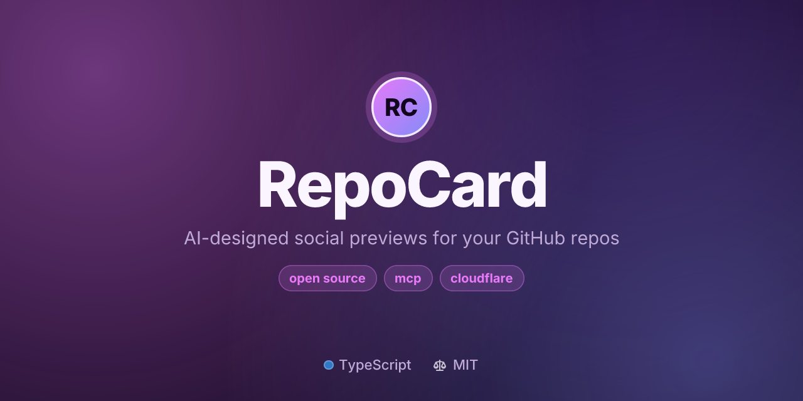

# repocard

AI-designed social preview images for GitHub repositories, from the command line.
Render one card, cards for every repo of an account, or upload them all to GitHub.



```bash
npx repocard card vercel/next.js          # → next.js.png (1280×640)
npx repocard bulk your-username           # → ./social-previews/*.png
npx repocard status your-username         # which repos already have a custom preview
npx repocard apply your-username          # dry run
npx repocard apply your-username --yes    # upload in your own browser
```

Requires Node.js 20+. Cards are rendered locally with the same engine as
[the RepoCard website](https://repocard.xyz), so no server is needed.

## Designs

- **Local, deterministic** (default): designs derived from the repo's language and metadata.
- **Local, AI**: set `LLM_BASE_URL`, `LLM_API_KEY` and `LLM_MODEL` to any OpenAI-compatible API
  (Groq, OpenRouter, Gemini, Together, Ollama).
- **Server, AI**: `--endpoint https://repocard.xyz` (or `REPOCARD_URL`) to use
  RepoCard's hosted designs.

## Uploading to GitHub

GitHub has no public API for the social preview. `repocard apply` drives the normal settings page in a
real browser that you sign in to yourself; your password and cookies never leave your machine.

```bash
npm install -g playwright && npx playwright install chromium   # once
npx repocard apply your-username --yes
```

- Nothing is uploaded without `--yes`.
- Repos that already have a custom preview are kept unless `--overwrite`.
- With a token (`GITHUB_TOKEN`, `GH_TOKEN`, or `gh auth login`) it skips repos where you aren't an
  admin and verifies each upload through the GitHub API.
- If GitHub changes its settings page, failures print the settings link and PNG path so you can finish by hand.

## Options

| Option | Description |
|---|---|
| `-o, --out` | Output file (`card`) or directory (`bulk`) |
| `-v, --variant 1-4` | Design concept |
| `--layout --palette --font --tagline` | Override parts of the design |
| `--endpoint <url>` | Use a RepoCard server |
| `--forks --archived --limit` | Repository selection |
| `--yes --overwrite --headless --delay --profile` | `apply` behavior |

Run `repocard --help` for everything. Source, docs and the GitHub Action: https://github.com/nirholas/RepoCard

MIT licensed. Bundled fonts are under the SIL Open Font License.
